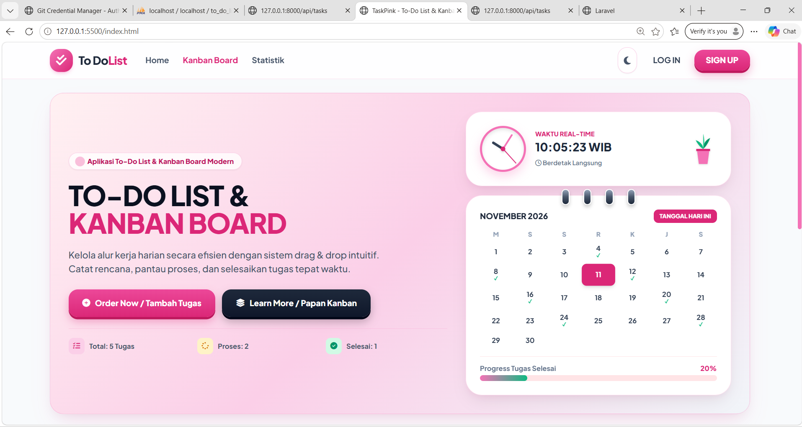

# 💖 TaskPink - Full-Stack Kanban & To-Do List Application

**TaskPink** adalah aplikasi manajemen tugas berbasis papan Kanban *full-stack* modern yang responsif. Projek ini menghubungkan antarmuka interaktif dengan backend API Laravel dan database MySQL untuk mengelola tugas secara *real-time*.




---

## ✨ Fitur Utama

- 📝 **Manajemen Tugas (Full CRUD)**: Tambah, lihat, ubah, dan hapus tugas secara instan.
- 📌 **Papan Kanban Interaktif**: Sinkronisasi status tugas (*Rencana*, *Proses*, *Selesai*) langsung ke database.
- 🔍 **Pencarian & Filter**: Filter tugas berdasarkan **Prioritas** (Tinggi, Sedang, Rendah) dan **Kategori**.
- 📊 **Statistik & Analisis**: Ringkasan performa dan rasio penyelesaian tugas.
- 🌓 **Mode Tampilan**: Pengoperasian tema terang (*Light Mode*) dan gelap (*Dark Mode*).
- ⚡ **RESTful API Synchronized**: Data tersimpan permanen di database MySQL melalui backend Laravel.

---

## 🛠️ Teknologi yang Digunakan

### Frontend
- **HTML5 & CSS3**
- **Tailwind CSS**
- **Vanilla JavaScript (ES6+)**

### Backend & Database
- **PHP**
- **Laravel Framework** (REST API)
- **MySQL**

---

## 🔌 Dokumentasi API Endpoints

| Method | Endpoint | Deskripsi |
| :--- | :--- | :--- |
| `GET` | `/api/tasks` | Mengambil seluruh daftar tugas |
| `POST` | `/api/tasks` | Membuat tugas baru |
| `PUT` | `/api/tasks/{id}` | Memperbarui detail / posisi kolom tugas |
| `DELETE` | `/api/tasks/{id}` | Menghapus tugas dari database |

---

## 🚀 Cara Menjalankan Projek di Lokal

### 1. Prasyarat
- PHP & Composer terinstall
- Web Server lokal (Laragon / XAMPP) dengan MySQL berjalan

### 2. Backend Setup (Laravel)
```bash
cd taskpink-backend
composer install
cp .env.example .env
php artisan key:generate
# Pastikan konfigurasi database di .env sudah sesuai
php artisan migrate
php artisan serve